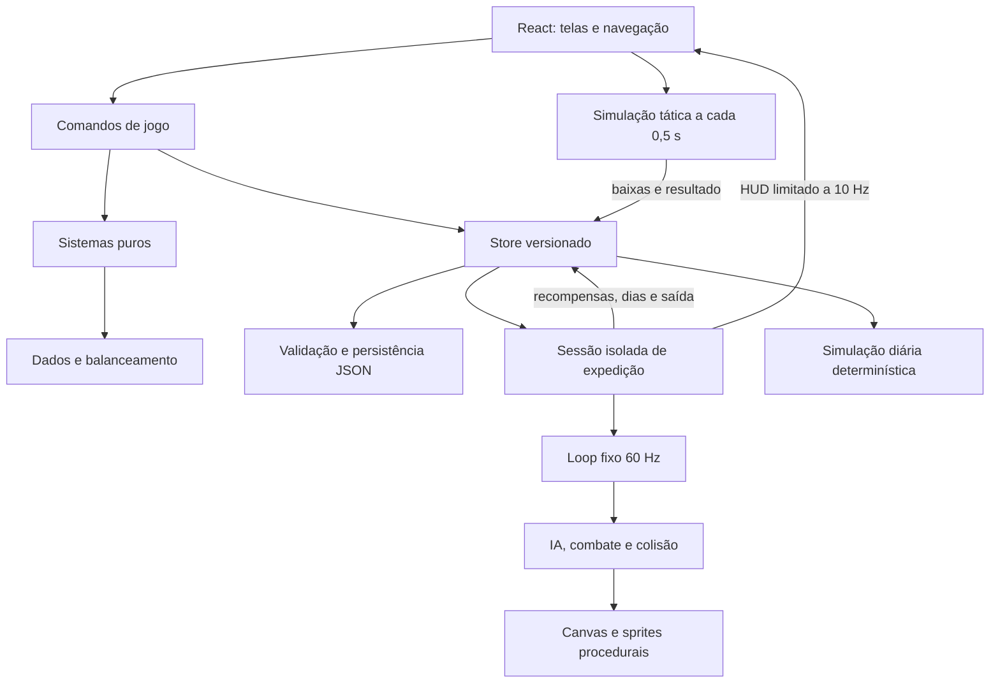

# Arquitetura de Eternal Realms

## Produto e decisões

O GDD define três escalas: personagem em ação, companhia em batalha e reino em simulação diária. A implementação mantém cada escala com relógio, estado transitório e regras próprios. Esta entrega é a prévia 0.1, com sistemas integrados e espaço explícito para completar o GDD.

Resolução de ambiguidades do documento:

- São **seis tiers raciais**, T0 a T5, conforme a regra detalhada, apesar do resumo mencionar cinco.
- Os slots listados somam **oito**, incluindo dois acessórios e uma relíquia. A menção a nove no checklist não corresponde à lista.
- A versão de save inicia em 1. Versões desconhecidas são rejeitadas; não existe uma migração fictícia de um formato anterior.
- Não há dependência do Google AI Studio para executar. O projeto Vite pode ser importado em um ambiente de desenvolvimento compatível.
- React renderiza gestão e HUD. Canvas executa a ação, evitando reconstruir árvores React a 60 Hz.
- Estado central usa `useSyncExternalStore`, com comandos transacionais e cópia explícita do estado. Não é necessário Zustand para este tamanho de projeto.

## Camadas

| Diretório     | Responsabilidade                                     | Dependências permitidas                      |
| ------------- | ---------------------------------------------------- | -------------------------------------------- |
| `src/data`    | Conteúdo e parâmetros                                | Tipos centrais                               |
| `src/state`   | Tipos, store, criação da campanha                    | Sistemas de criação e save                   |
| `src/systems` | Fórmulas, progressão, comandos, economia e validação | Dados e tipos; nenhuma API de renderização   |
| `src/engine`  | Input, loop, mapas, colisão, câmera, áudio e Canvas  | Dados e sistemas; sem componentes React      |
| `src/ui`      | Telas e componentes                                  | Comandos, store e sessões de motor           |
| `tests`       | Invariantes e simulações                             | Módulos públicos e ambiente gráfico simulado |

O motor de ação está concentrado em `ActionEngine`, com input, geração de zona, loop e desenho de sprites extraídos. Quando novas famílias de skills entrarem, separar `CombatSystem`, `EnemySystem`, `StatusSystem` e `ZoneRenderer` evita tornar a classe um ponto de acoplamento excessivo.

## Estado e transações

`SaveGame` contém personagem, companhia, itens, recursos, regiões visitadas, limpezas, perigos, diário, reinos, territórios, esquadrões, missões, pesquisas e configurações. `Character` contém a ficha usada pelo jogador e pelos recrutas. Os dados não dependem de elementos DOM, áudio ou Canvas.

`updateGame(command)` clona a campanha, aplica uma regra, troca a referência e tenta salvar. Comandos validam condições relevantes no domínio: não é suficiente desabilitar o botão. Exemplos: impedir contrato duplicado, contratar o mesmo recruta duas vezes, evoluir sem recursos e construir além dos slots.

A expedição usa uma cópia própria para não notificar React a cada frame. Recompensas, troca de dia e encerramento gravam snapshots. Ao desmontar a tela, listeners e animação são removidos. Uma nova expedição recomeça a zona; posição, HP dos inimigos e sala atual são transitórios. Não há recuperação de uma sala em andamento após fechar a aba.

Na batalha tática, resultados são aplicados uma única vez. Sair da tela preserva as baixas existentes como retirada. A posição de cada tropa não é simulada: cada esquadrão é agregado.

## Determinismo

- RNG: `mulberry32`, com hash de strings estável.
- Recrutas: seed da campanha + região/cidade + semana.
- Mundo: seed da campanha + dia.
- Expedição: seed + nó + limpezas + dia; salas derivam da seed da dungeon.
- Encontros e loot utilizam a sequência RNG da sessão. Interações diferentes consomem a sequência em ordens diferentes.
- Testes exercitam diversas seeds, custo de atributos, limites e reprodutibilidade.

O gerador constrói uma estrada atravessando a zona e usa flood fill para selecionar spawns alcançáveis. Movimento impede atravessar tiles bloqueados. Companheiros usam seguimento simplificado e não navegam com A* nesta prévia.

## Relógios e persistência

| Relógio  | Frequência              | Comportamento                                        |
| -------- | ----------------------- | ---------------------------------------------------- |
| Ação     | 60 Hz fixos             | Acumulador, dt limitado; pausa em P/Tab e aba oculta |
| HUD      | Até 10 Hz               | Barras, cooldowns e mensagens                        |
| Batalhão | 0,5 s                   | Pausa e ordens; estado do resultado persistido       |
| Mundo    | 90 s por dia na ação    | Configurável; viagem avança um dia                   |
| Gestão   | Sem passagem automática | Botão de administrar permite avanço explícito        |

`localStorage` é protegido com try/catch. A importação faz validação estrutural profunda e limites numéricos antes de substituir o estado. Arquivo limitado a 4 MB e inventário a 500 itens. Nenhuma chave externa é necessária. `ErrorBoundary` permite recarregar se uma falha de UI escapar das validações.

Versão 2 deverá acrescentar migração explícita e testes com fixtures v1. Atualizações de catálogo deverão manter IDs estáveis e migrar IDs descontinuados, nunca resolver silenciosamente para conteúdo diferente.

## Matriz de cobertura do GDD

| Área               | Implementado nesta prévia                                                                                                 | Ainda necessário para o GDD completo                                                                                                                |
| ------------------ | ------------------------------------------------------------------------------------------------------------------------- | --------------------------------------------------------------------------------------------------------------------------------------------------- |
| Fundação           | React/TS strict/Vite, motor, navegação, saves, export/import                                                              | Migrações futuras, recuperação de sessão, múltiplos slots                                                                                           |
| Criação            | 24 raças, seis classes, point-buy, paletas, afinidades e formas sorteadas                                                 | Bônus humanos escolhidos livremente, estética detalhada, passivas/ativas raciais exclusivas                                                         |
| Raças              | Modificadores, origem, afinidade, nomes de evolução e T1–T5                                                               | Slime desbloqueável, Devorar, quarto ramo, alinhamentos e skills de cada tier                                                                       |
| Classes            | Seis conjuntos de nomes, ataques melee/ranged, quatro ações, primeira especialização e secundária                         | Comportamentos exclusivos por classe, árvores reais nos níveis 40/70, híbridas e passivos 60%                                                       |
| Ação               | Movimento, colisão, combo, crítico, esquiva, skills, regen, projéteis, inimigos e chefe com mudanças por HP               | Mira direcional completa, telegrafia de projéteis, todos os status, resistências elementais, skills raciais, companheiros com dano/colisão próprios |
| Magia              | Sete afinidades, cinco páginas, melhoria e contribuição para dano/PW                                                      | Magias independentes equipáveis, treino, afinidades avançadas funcionais, formas únicas reais, página proibida/corrupção                            |
| Evolução/Despertar | Gates de nível/essência/chefes, ramo fixado em T2, evolução, recompensa da missão nv15                                    | Cutscenes, gatilhos aleatórios, pity, despertar de linhagem e títulos separados                                                                     |
| Mundo              | 16 regiões selecionáveis, cidade/ermos/dungeon por região, cores de bioma e viagem                                        | Três anéis, múltiplas cidades/dungeons, grafo de adjacências, navios, chefes e recursos próprios                                                    |
| Dungeons           | Salas lineares, seed, elites, descanso, baú, chefe, seis modificadores com efeitos                                        | Grafo ramificado, 12 modificadores, portais vermelhos, 24 padrões exclusivos de chefe, primeira limpeza única                                       |
| Itens              | Loot ponderado, raridade, slots, equipamento, compra e venda                                                              | Afixos, conjuntos, relíquias especiais, crafting, armas visualmente distintas                                                                       |
| Missões            | 12 contratos de contagem, progresso e recompensa única                                                                    | Escolta, coleta de itens, objetivos específicos por região, narrativa encadeada                                                                     |
| Companhia          | Recrutas semanais, custo, salário, personalidade/traço descritivos, grupo, ordens, lealdade, abandono                     | Efeitos dos traços, preferências por ação, tradição, traição, fichas editáveis de oficiais e personagens únicos                                     |
| Batalhão           | Até cinco esquadrões, oficiais com aura, moral, counter, quatro ordens, três cenários, baixas e captura                   | Movimento espacial, terreno, adjacência, comando em ação, outras ordens, Legião/Exército e 40 oficiais de campanha                                  |
| Reino              | Vila/cidade/fortaleza/capital, 12 construções com produção genérica, slots, tributos, estabilidade, manutenção e pesquisa | Funções específicas de cada prédio, custos multirrecurso, rebeliões, leis, hierarquia formal, árvore de 60 pesquisas                                |
| Diplomacia/IA      | Rank A, relações, tributos, guerra/trégua, políticas diárias e ataques à estabilidade                                     | Alianças/comércio/espionagem/sabotagem, conquista entre NPCs, destruição real de cidades, vassalagem                                                |
| Mundo vivo         | Perigo crescente, ruptura em sete dias, cinco eventos de diário e ataques reais em guerras declaradas                     | Eventos com consequências específicas, migração, doze eventos completos, personalidades políticas avançadas                                         |
| Domesticação       | Não implementada                                                                                                          | Criaturas, alimentação, montarias, familiares, captura e evolução                                                                                   |
| Polimento          | UI PT-BR, áudio sintetizado, minimapa, tooltips, dica inicial, configurações                                              | Tutorial completo, remapeamento, música, pooling, benchmark 200 entidades e campanha balanceada                                                     |
| IA opcional        | Não utilizada, jogo sem serviço externo                                                                                   | Adaptador narrativo Gemini com backend e fallback, se desejado                                                                                      |

Essas diferenças são intencionais e ficam visíveis como limitações da prévia, não como fases finalizadas. Não há alegação de 60 FPS em hardware não medido nem de campanha completa até o nível 100.

## Plano de expansão técnica

1. **Contratos de efeito:** introduzir `EffectDef` discriminado (`Damage`, `Heal`, `Shield`, `Summon`, `Status`, `Teleport`), `SkillDef`, alvo, custo, cooldown e tags. UI e engine consumirão o mesmo catálogo.
2. **Personagens únicos:** substituir descrições de traços por modificadores puros calculados em `stats`; guardar escolhas de humano, racial, especialização e híbrida com IDs.
3. **Entidades:** extrair estruturas `Transform`, `Combatant`, `StatusInstance`, `Projectile` e usar pools limitados. O save persiste deltas de encontro, não referências do motor.
4. **Mundo em grafo:** separar `Region` de `MapNode`; arestas determinam duração, perigo e requisito de viagem. Nós identificam cidade, vila, ruína, porto e dungeon.
5. **Quests:** grafo de objetivos tipados com eventos de domínio (`EnemyKilled`, `ItemCollected`, `NodeVisited`, `DungeonCleared`). Recompensas idempotentes.
6. **Simulação estratégica:** ticks puros recebem comandos/ordens e devolvem eventos. IA avalia utilidade ponderada por personalidade, fronteira, ameaça, alimento e riqueza.
7. **Save v2:** sequência RNG persistida, missão composta, instância de dungeon e transação econômica; migração v1→v2 com fixtures.
8. **Teste de campanha:** simular mil dias, guerras e abandono; executar cenários que demonstram cada Rank/desbloqueio. Benchmark real de 200 entidades e medição p95 de frame antes de afirmar performance.
